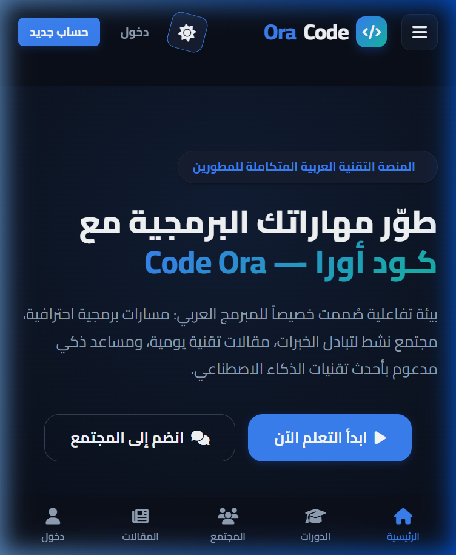
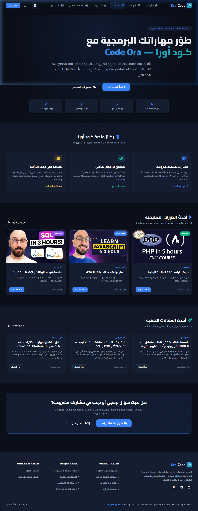
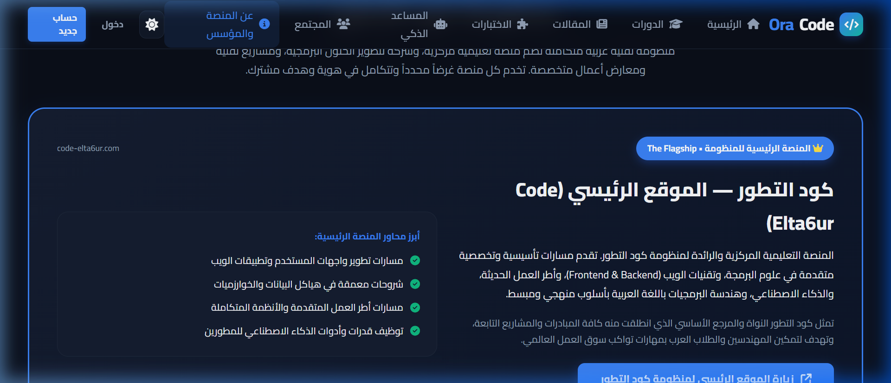

<p align="center">
  
</p>

<h1 align="center">كـود أورا — Code Ora</h1>

<p align="center">
  <strong>المنصة التقنية العربية المتكاملة للمطورين والمبرمجين</strong><br>
  <em>إحدى منصات منظومة كود التطور (Code Elta6ur Ecosystem)</em>
</p>

<p align="center">
  <a href="https://code-ora.com"></a>
  &nbsp;
  <a href="#-حقوق-الملكية-والترخيص"></a>
  &nbsp;
  <a href="https://code-elta6ur.com"></a>
</p>

<p align="center">
  <a href="#-عن-المنصة">عن المنصة</a> •
  <a href="#-المشكلة-والحل">المشكلة والحل</a> •
  <a href="#-أبرز-الميزات">الميزات والوظائف</a> •
  <a href="#-معرض-الصور-الحقيقي">معرض الصور</a> •
  <a href="#-الهندسة-والمعمارية">الهندسة والمعمارية</a> •
  <a href="#-المؤسس-ومنظومة-كود-التطور">المؤسس والمنظومة</a> •
  <a href="#- تواصل">التواصل</a>
</p>

---

## 🌐 عن المنصة (About Code Ora)

**Code Ora (كود أورا)** هي منصة تقنية وتطبيقية عربية أسسها ويقود تطويرها هندسياً **محمد أبو خشريف** ضمن **منظومة كود التطور**. تم تصميم المنصة لتكون بيئة رقمية متكاملة تجمع بين المسارات التعليمية المرئية، والمجتمع البرمجي التفاعلي الحي، ومحرك النشر اليومي الذكي للمقالات الهندسية، واختبارات قياس الكفاءة البرمجية.

> [!NOTE]
> هذا المستودع مخصص كـ **واجهة استعراض وتوثيق عام (Public Showcase)** للمشروع وميزاته ومعماريته. الكود المصدري للمشروع خاص ومحمي بالكامل وغير متاح للتحميل أو التوزيع العام.

---

## 🎯 المشكلة التي يحلها المشروع (The Problem & Solution)

| التحدي الواقعي في المحتوى البرمجي العربي | الحل المطبق في Code Ora |
| :--- | :--- |
| **التشتت بين منصات المشاهدة ومنصات النقاش:** اضطرار المطور للتنقل بين يوتيوب ومجموعات فيسبوك ومواقع المقالات. | **بيئة واحدة مدمجة:** مسارات الدورات، ومحرر مشاركة الأكواد، والمقالات، ومجتمع النقاشات في واجهة موحدة. |
| **ركود المحتوى التقني والاعتماد على التدوين اليدوي المتقطع:** توقف الكثير من المدونات بعد فترات قصيرة. | **محرك النشر اليومي الآلي:** نظام جدولة ونشر مؤتمت يولد مقالات هندسية متعمقة يومياً وفق معايير جودة صارمة. |
| **صعوبة مشاركة وتنسيق الأكواد على الهواتف:** تشوه نصوص البرمجة على الشاشات الصغيرة. | **تصميم موجه للهواتف (Mobile-First):** شريط تنقل سفلي مرن، وتظليل Prism مخصص، ودعم كامل للوضع الليلي (Dark Mode). |
| **تتبع ملفات تعريف الارتباط وبطء المشغلات:** استخدام مشغلات تتبع تقليدية تبطئ التصفح. | **خدمة VideoService الآمنة:** تضمين خصوصي متجاوب 16:9 عبر نطاق `youtube-nocookie.com`. |

---

## 🚀 أبرز الميزات والوظائف (Key Features)

### 1. المسارات والدورات التعليمية (Learning Tracks)
- دورات متخصصة في تطوير الويب، الواجهات الأمامية والخلفية، قواعد البيانات، والأمن السيبراني.
- مشغلات فيديو آمنة ومحسنة للخصوصية والسرعة بنسبة عرض 16:9 متجاوبة.
- تتبع لحظي لتقدم الطالب في كل درس ودورة.

### 2. محرك النشر اليومي الآلي (Automated Daily Publishing Engine)
- محرك هندسي ذاتي التشغيل يولد مقالاً تقنياً متعمقاً كل صباح.
- دعم التكامل المزدوج (ذكاء اصطناعي عبر السحاب + محرك معرفة محلي عالي الجودة لضمان الاستمرارية وعدم الانقطاع).
- نظام فحص الجودة، الأرشفة، وتوليد الروابط الدلالية (Slugs) لمحركات البحث تلقائياً.

### 3. مجتمع المطورين التفاعلي (Developer Community)
- مساحة تفاعلية للمنشورات البرمجية، الأسئلة التقنية، والمناقشات.
- محرر متقدم لمشاركة الأكواد مع تظليل لوني لجميع اللغات (Syntax Highlighting) وزر نسخ الكود بنقرة واحدة.
- تفاعلات لحظية فائقة السرعة بتقنية **Optimistic UI** للإعجابات والتعليقات دون إعادة تحميل الصفحة.
- مجموعات برمجية تخصصية وتحديات برمجية مستمرة.

### 4. تحديات واختبارات القدرات (Quizzes & Challenges)
- بنك أسئلة واختبارات لقياس الاستيعاب البرمجي والمفاهيم الهندسية.
- تصحيح فوري مع تحليل النتيجة واحتساب نقاط الخبرة ورتب الحسابات.

### 5. نظام التصميم والوضع الليلي (Design System & Dark Mode)
- واجهة مستخدم عصرية مستوحاة من أحدث معايير الويب العالمية بـ Vanilla CSS دون أطر ثقيلة.
- دعم متكامل للوضع الليلي المريح للعين (Dark Mode) والوضع الفاتح مع حفظ تفضيل المستخدم فورياً.
- خطوط طباعة احترافية مخصصة للمطورين: **Cairo** للنصوص العربية والإنجليزية و **Fira Code** للأكواد.

---

## 📸 معرض الصور الحقيقي للمنصة (Visual Showcase)

### الصفحة الرئيسية (Light & Dark Mode)
| الوضع النهاري (Light Mode) | الوضع الليلي للمطورين (Dark Mode) |
| :---: | :---: |
|  |  |

---

### تجربة الهواتف الذكية (Mobile-First Experience)
<p align="center">
  
</p>
<p align="center"><em>شريط تنقل سفلي مريح بالإبهام، تظليل أكواد متجاوب، وانعدام تام للتمرير الأفقي غير المرغوب فيه.</em></p>

---

### المسارات التعليمية والمجتمع البرمجي
| المسارات والدورات التعليمية | مجتمع المطورين ومشاركة الأكواد |
| :---: | :---: |
|  |  |

---

### المقالات اليومية وصفحة المؤسس والمنظومة
| المقالات التقنية اليومية | صفحة المؤسس ومنظومة كود التطور |
| :---: | :---: |
|  |  |

---

## 🛠️ الهندسة والمعمارية (Architecture & Tech Overview)

بُنيت المنصة داخلياً بمعمارية مخصصة تجمع بين السرعة والأمان وسهولة التوسع:

```
📦 Code Ora Platform Architecture
├── 🏛️ Clean Custom MVC — معمارية مخصصة خفيفة خالية من الاعتماديات الخارجية المعقدة
├── 🗄️ Multi-Driver Database Layer — دعم مرن لقواعد بيانات MySQL السحابية و SQLite المحلية
├── 🔒 Enterprise-Grade Security — حماية مدمجة ضد ثغرات CSRF و XSS و SQL Injection
├── ⚡ Optimistic UI Engine — تفاعلات شبكية غير متزامنة (AJAX) واستجابات فورية
├── 🤖 Automated Publishing Pipeline — نظام نشر آلي ذكي ومجدول عبر cron
└── 📱 Responsive Vanilla CSS Tokens — نظام ألوان ومكونات دقيق بدون مكتبات خارجية ثقيلة
```

---

## 👤 المؤسس ومنظومة كود التطور (Founder & Ecosystem)

يقود تطوير منصة **Code Ora** هندسياً ومعمارياً:

### **محمد أبو خشريف (Mohammad Abu Kashreef)**
*المطور الرئيسي ومؤسس Code Ora ضمن منظومة كود التطور*

مهندس ومطور برمجيات متكامل (Full-Stack Engineer) يركز على هندسة النظم الرقمية المترابطة، والحلول السحابية، وتطوير المنتجات البرمجية والتعليمية التي تخدم المبرمجين العرب.

- 🌐 **الموقع الشخصي والأعمال:** [mohammad.code-elta6ur.com](https://mohammad.code-elta6ur.com)
- 🐙 **حساب GitHub المصدري:** [github.com/mokashreef](https://github.com/mokashreef)

---

### 🌐 منظومة كود التطور (Code Elta6ur Ecosystem)
تتكامل Code Ora مع شبكة منصات ومشاريع منظومة كود التطور:

1. **المنصة الرئيسية لكود التطور (The Flagship):** [https://code-elta6ur.com](https://code-elta6ur.com) — المنصة التعليمية المركزية الرائدة.
2. **شركة البرمجيات:** [Code Elta6ur Software](https://code-elta6ur.net) — الحلول البرمجية المؤسسية وتطوير الأنظمة.
3. **معرض الأعمال:** [Code Elta6ur Portfolio](https://portfolio.code-elta6ur.net) — استعراض النماذج البرمجية والمشاريع المنفذة.
4. **منصة Code Ora:** [Code Ora](https://code-ora.com) — المنصة التطبيقية والمجتمعية الحالية.
5. **منصة البكالوريا السورية:** [Code Elta6ur Baccalaureate](https://baccalaureate.code-elta6ur.sy) — الموارد والمناهج الأكاديمية.
6. **منصة العتاد والمخططات:** [HardwareBase by Code Elta6ur](https://hardwarebase.code-elta6ur.com) — مخططات وهندسة العتاد والإلكترونيات.
7. **البوابة الإقليمية:** [Code Elta6ur Syria](https://code-elta6ur.sy) — مبادرات وخدمات كود التطور في سوريا.

---

## 🔒 حقوق الملكية والترخيص (Proprietary Notice)

> **All Rights Reserved &copy; 2026 Mohammad Abu Kashreef &bull; Code Elta6ur Ecosystem**

- جميع الحقوق الفكرية، والمعمارية، والتصميم، والكود المصدري لمنصة **Code Ora** محفوظة بالكامل للمؤسس **محمد أبو خشريف** ومنظومة **كود التطور**.
- هذا المستودع مخصص لأغراض العرض والتوثيق التقني العام فقط (Showcase Portfolio).
- يُمنع نسخ، أو إعادة إنتاج، أو استغلال الكود المصدري أو المواد الخاصة بالمنصة تجارياً أو برمجياً دون إذن خطي مسبق.

---

## 📬 تواصل (Contact)

- 🌐 **الموقع المباشر:** [code-ora.com](https://code-ora.com)
- 💼 **موقع المؤسس:** [mohammad.code-elta6ur.com](https://mohammad.code-elta6ur.com)
- 🐙 **GitHub:** [github.com/mokashreef](https://github.com/mokashreef)
- 📧 **البريد الإلكتروني:** [mo.abukashreef@gmail.com](mailto:mo.abukashreef@gmail.com)
