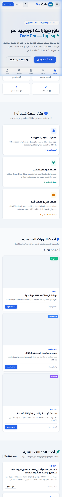
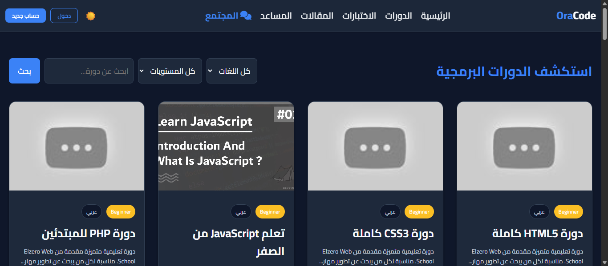
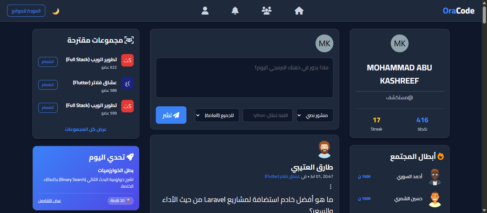
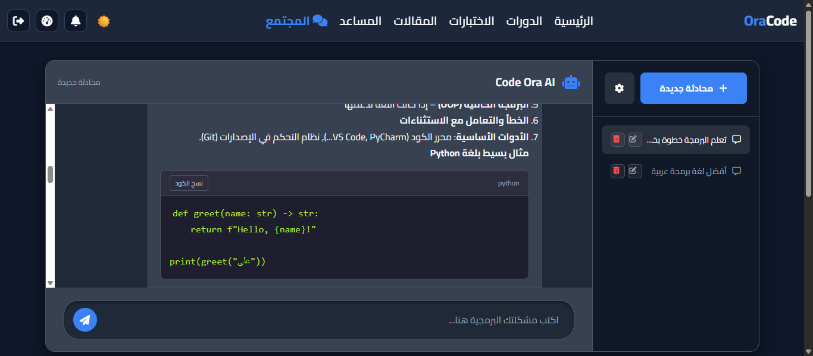
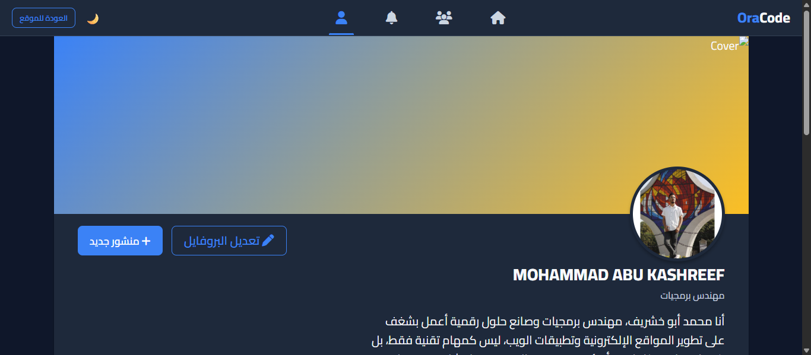
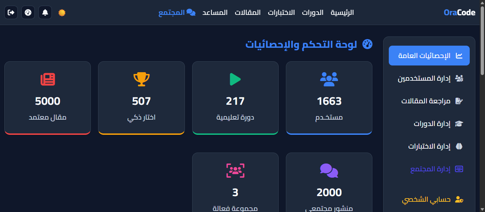

<div align="center">

<!-- Logo Placeholder — استبدل الرابط بشعار المشروع -->


<br/>

# 「 كـود أورا — Code Ora 」

### 🌐 المنصة التقنية العربية الأولى للمبرمجين والمطورين

<br/>

<p align="center">
  <em>بيئة متكاملة تجمع بين التعليم المنهجي، المجتمع التفاعلي، والذكاء الاصطناعي — كل ما يحتاجه المبرمج العربي في مكان واحد.</em>
</p>

<br/>

<!-- Badges -->
[](#)
&nbsp;
[](#)
&nbsp;
[](#)

<br/>

[](#)
[](#)
[](#)
[](#)
[](#)
[](#)
[](#)

<br/>

---

</div>

<br/>

## 📋 Table of Contents

<div align="center">

[✨ Features](#-features) · [📸 Screenshots](#-screenshots) · [🛠️ Tech Stack](#️-tech-stack) · [🎯 Target Audience](#-target-audience) · [📬 Contact](#-contact)

</div>

<br/>

## ✨ Features

<table>
<tr>
<td width="50%">

### 📚 المنصة التعليمية
| | |
|---|---|
| 🎓 | **مسارات تعليمية مُمنهجة** — دورات شاملة تغطي لغات البرمجة من الأساسيات إلى الاحتراف |
| 📝 | **مقالات تقنية ثرية** — مدونة تقنية تواكب أحدث التقنيات وأفضل الممارسات |
| 🧩 | **اختبارات وتحديات تفاعلية** — اختبر مستواك مع تحديات يومية محفّزة |
| 📊 | **تتبّع التقدم** — مؤشرات إنجاز وإحصائيات أداء مُفصّلة لكل مستخدم |

</td>
<td width="50%">

### 🌍 المجتمع التفاعلي
| | |
|---|---|
| 💬 | **شبكة اجتماعية للمبرمجين** — إعجابات، تعليقات، مشاركات، وإشعارات لحظية |
| 👥 | **مجموعات برمجية متخصصة** — مساحات مركّزة حول تقنيات واهتمامات محددة |
| 💡 | **مشاركة الأكواد** — نشر الأكواد البرمجية مع دعم Syntax Highlighting |
| 🏆 | **نظام نقاط ومستويات** — نظام Gamification يعكس خبرتك ونشاطك |

</td>
</tr>
<tr>
<td colspan="2">

### 🤖 المساعد الذكي (AI Assistant)
| | |
|---|---|
| 🧠 | **شرح الأكواد البرمجية** — فهم فوري لأي كود مع شرح مُبسّط |
| 🐛 | **تصحيح الأخطاء (Debugging)** — حلول ذكية ومقترحات لإصلاح الأخطاء |
| 💭 | **اقتراحات برمجية** — توصيات مخصصة لتحسين الكود وأفضل الممارسات |
| ⚡ | **واجهة دردشة تفاعلية** — تجربة سلسة ومتجاوبة بالكامل (Responsive) |

</td>
</tr>
</table>

<br/>

## 📸 Screenshots

<div align="center">

> 💡 *لقطات الشاشة توضح الواجهات الرئيسية للمنصة*

<br/>

<!-- استبدل الصور التالية بلقطات شاشة حقيقية من المشروع -->

| الصفحة الرئيسية | صفحة الدورات |
|:---:|:---:|
|  |  |
| **Home Page** | **Courses Page** |

| المجتمع التفاعلي | المساعد الذكي |
|:---:|:---:|
|  |  |
| **Community Feed** | **AI Assistant** |

| الملف الشخصي | لوحة الإدارة |
|:---:|:---:|
|  |  |
| **User Profile** | **Admin Dashboard** |

</div>

<br/>

## 🛠️ Tech Stack

<div align="center">

| الطبقة | التقنيات |
|:---:|:---|
| **Backend** |  &nbsp;  |
| **Frontend** |  &nbsp;  &nbsp;  |
| **Database** |  |
| **Interaction** |  &nbsp;  |
| **AI** |  |

</div>

<br/>

### 🏗️ Architecture Highlights

```
📦 Code Ora
├── 🔧 معمارية MVC مخصصة — بناء داخلي بدون أُطر عمل خارجية
├── ⚡ Optimistic UI — تفاعلات لحظية بتقنية AJAX
├── 🔐 نظام صلاحيات متقدم — إدارة أدوار المستخدمين والمشرفين
├── 🤖 تكامل مع الذكاء الاصطناعي — مساعد ذكي مدمج
└── 📱 تصميم متجاوب — تجربة مثالية على جميع الأجهزة
```

<br/>

## 🎯 Target Audience

<div align="center">

| | الجمهور المستهدف | الوصف |
|:---:|:---|:---|
| 👨‍💻 | **المبرمجون العرب المبتدئون** | يبحثون عن محتوى تعليمي منظم بلغتهم الأم |
| 🚀 | **المطورون المتوسطون** | يريدون صقل مهاراتهم والتعلم من مجتمع نشط |
| 💼 | **المحترفون** | يبحثون عن مجتمع تقني عربي لتبادل الخبرات وبناء علاقات مهنية |
| 🎓 | **طلاب تخصصات الحاسوب** | يحتاجون لمرجع عربي شامل يدعم مسيرتهم الأكاديمية |

</div>

<br/>

## 🌟 Demo

<div align="center">

<!--
  إذا أصبح الديمو متاحاً مستقبلاً، استبدل الرابط أدناه:
-->

[](#)

<br/>

> ⚠️ *الديمو الحي غير متوفر حالياً — المشروع قيد التطوير النشط.*

</div>

<br/>

## 📬 Contact

<div align="center">

<br/>

**Mohammad Abu Kashreef**

[](https://github.com/MOHAMMAD-ABU-KASHREEF)
&nbsp;
[](mailto:your-email@example.com)
&nbsp;
[](https://linkedin.com/in/your-profile)

<br/>

> 💬 *لا تتردد في التواصل معي لأي استفسارات أو فرص تعاون.*

</div>

<br/>

---

<div align="center">

<br/>


**Built With ❤️ by [MOHAMMAD ABU KASHREEF](https://github.com/MOHAMMAD-ABU-KASHREEF)**

<sub>كـود أورا — لأن كل مبرمج عربي يستحق منصة بمستوى طموحه 🚀</sub>

<br/><br/>

</div>
